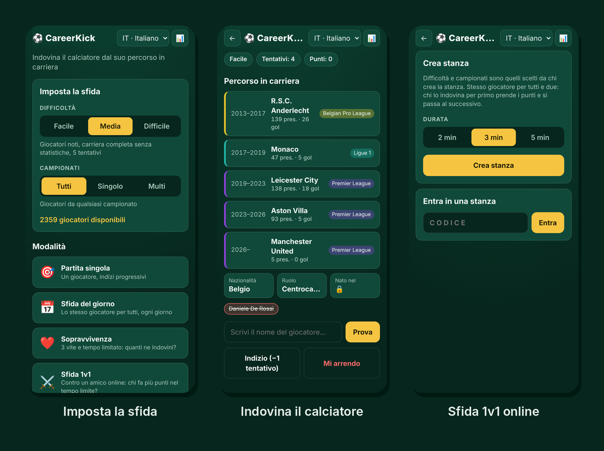
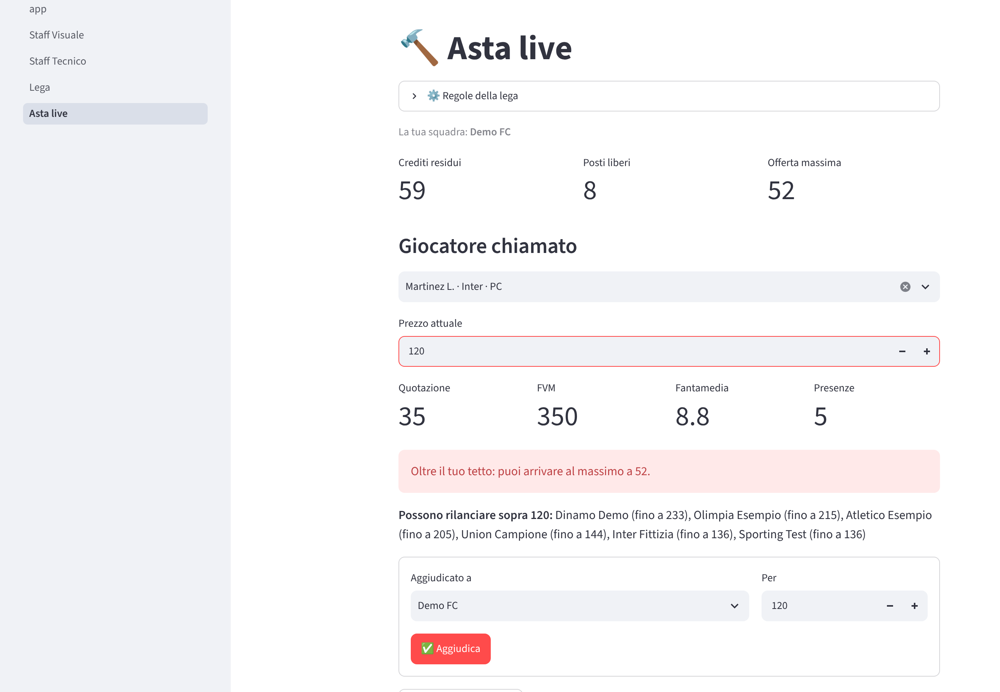

# Ciao, sono Tommaso 👋

**Web developer junior** di Montevarchi (AR). Costruisco web app che risolvono problemi concreti, partendo da quelli che conosco bene: il calcio e il fantacalcio.

Cerco un primo ruolo come sviluppatore web, in ufficio o da remoto.

---

## 🚀 Progetti in evidenza

### ⚽ [CareerKick](https://github.com/DemolitionWeb/CareerKick) · [careerkick.it](https://careerkick.it)
Quiz web: indovina il calciatore dal suo percorso in carriera.

- **6 lingue**, 3 livelli di difficoltà, sfida del giorno, modalità sopravvivenza
- **Sfida 1v1 online** tra due browser con WebRTC (PeerJS), senza server né account
- **~4.650 giocatori** importati da Wikidata con uno script Node.js
- **PWA** installabile e utilizzabile offline
- **GitHub Actions**: pubblicazione automatica su GitHub Pages e aggiornamento dei giocatori dopo ogni calciomercato

`JavaScript` `HTML` `CSS` `Node.js` `WebRTC` `GitHub Actions`

### 🧠 [FantaMantra AI](https://github.com/DemolitionWeb/FantaMantraAI)
Assistente per l'asta e la stagione del Fantacalcio Mantra.

- Durante l'asta dal vivo calcola **crediti residui, posti liberi e offerta massima** di ogni squadra della lega
- Importa listone, rose e classifica di Serie A da più fonti (CSV e API)
- Un **AI Coach** (API OpenAI) commenta i dati, ma non sostituisce i calcoli: crediti e regole restano deterministici
- Database **SQLite** e **test automatici** con pytest

`Python` `Streamlit` `SQLite` `OpenAI API` `pytest`

### 🌱 Primi esercizi
- [Portfolio](https://github.com/DemolitionWeb/Project): il mio sito personale, con tema chiaro e scuro · [aprilo](https://demolitionweb.github.io/Project/)
- [Calcolatrice](https://github.com/DemolitionWeb/Calculator) · [provala](https://demolitionweb.github.io/Calculator/Index.html)
- [Contatore](https://github.com/DemolitionWeb/Progetto-Javas-TommasoDominici) · [provalo](https://demolitionweb.github.io/Progetto-Javas-TommasoDominici/Index.html)

---

## 🛠️ Cosa uso

**Lavoro tutti i giorni con:** HTML · CSS · JavaScript · Git e GitHub

**Ho usato nei progetti:** Python · Streamlit · SQLite · Node.js · GitHub Actions · GitHub Pages · Netlify

**Conosco le basi di:** PHP · MySQL

**Strumenti AI:** uso Claude e ChatGPT per lavorare più velocemente, e rivedo e capisco il codice che finisce nei miei progetti

---

## 📫 Contatti

- 💼 [LinkedIn](https://www.linkedin.com/in/tommaso-dominici-a543112aa)
- ✉️ dominicitommaso2@gmail.com
- 🌐 [Portfolio](https://demolitionweb.github.io/Project/)
